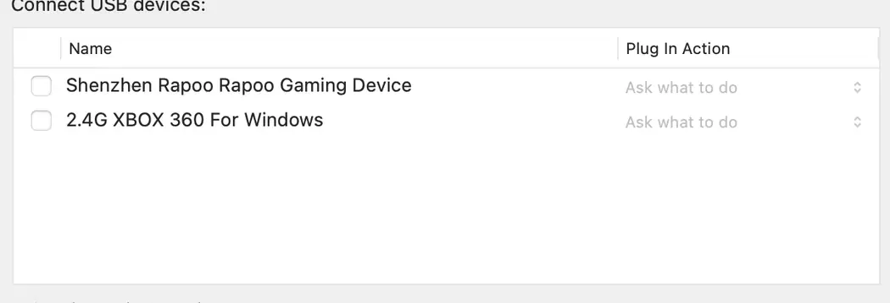
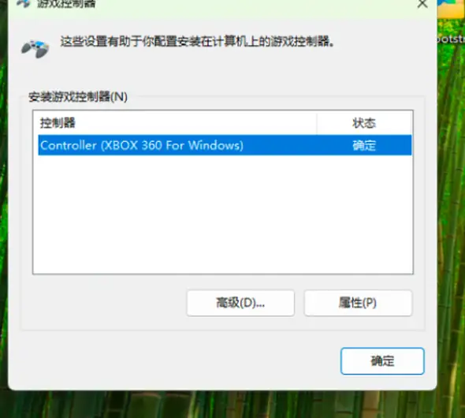
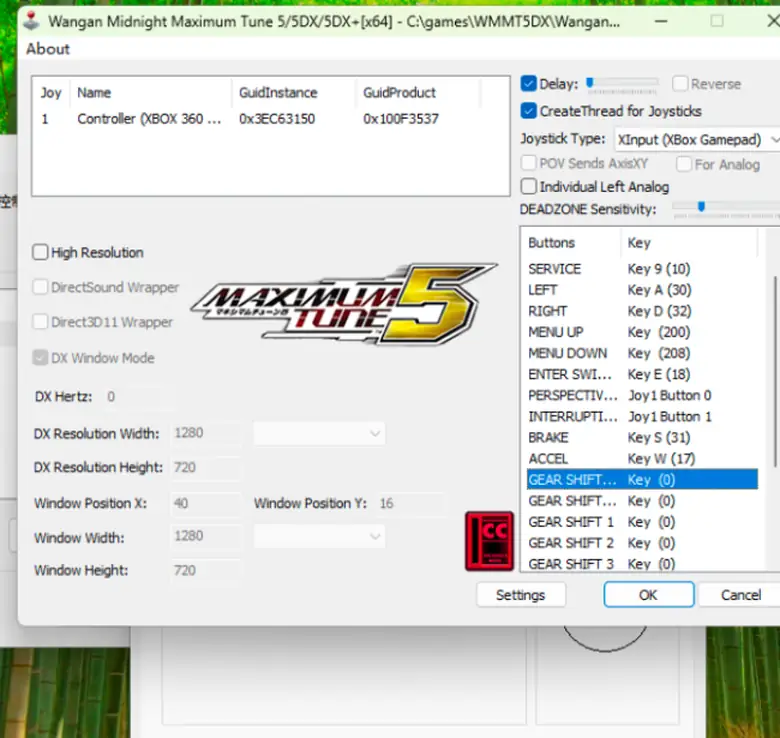

# 🏎️ WMMT5DX Apple Silicon Guide

### M 芯片 Mac 运行《湾岸5DX》及 Xbox 手柄适配指南

**[简体中文](#中文指南) | [English](#english-summary)**

<a id="中文指南"></a>

本项目记录了在 **Apple Silicon Mac** 上，通过 **VMware Fusion + Windows 11 ARM + JConfig** 运行《湾岸5DX》，并使用 Xbox 兼容手柄控制的实测过程。

针对 VMware USB 设备列表中找不到手柄、Windows ARM `joy.cpl` 无法识别控制器、JConfig 数字按键或模拟踏板无法工作的情况提供排查步骤。

## ✅ 测试环境与验证范围

| 项目 | 本次测试配置 |
|---|---|
| 电脑 | Apple Silicon Mac |
| 虚拟化 | VMware Fusion |
| 虚拟机操作系统 | Windows 11 ARM64 |
| 游戏 | Wangan Midnight Maximum Tune 5DX |
| 输入工具 | JConfig 1.8 |
| 手柄 | 盖世小鸡启明星 2（GameSir Nova 2 Lite） |
| 连接方式 | USB 数据线、绿色 Xbox/XInput 模式 |

**已实测**：Windows 能识别控制器；JConfig 接收 XInput 数字按钮；游戏内可使用手柄进入 Test Mode；方向盘、油门、刹车在游戏测试界面有响应。

**仍需验证**：`Fake Analog Pedals` 是否保留 RT/LT 的完整线性踏板精度；其他手柄型号和 VMware 版本的兼容性。本指南不保证所有环境均适用。

## 🔧 安装与配置

### 1. 让 VMware 显示隐藏的 Xbox USB 手柄

1. **完全关机** Windows 虚拟机，不要只暂停。
2. 退出 VMware Fusion。
3. 在 Finder 中找到 `.vmwarevm` 虚拟机包，右键选择「显示包内容」。
4. **备份原始 `.vmx` 文件**，再用文本编辑器打开它。
5. 如果下面的键不存在，新增一行；如果已经存在，只修改原来的值：

   ```ini
   usb.generic.allowHID = "TRUE"
   ```

6. 保存并重启 VMware。前往虚拟机的 USB 设备设置，寻找 `XBOX 360 For Windows`（名称可能因型号而异）。

**切勿把 Mac 键盘或鼠标错误地直通到 Windows。** 本次测试的鼠标在列表中显示为 `Shenzhen Rapoo Rapoo Gaming Device`，不是手柄。



### 2. 手柄 USB 直通与 Windows 测试

1. 用 USB 数据线将手柄连接到 Mac。
2. 启明星 2 切换到 **绿色 Xbox / XInput 模式**（本次测试按住 M 查看模式灯颜色）。
3. 在 VMware 的「USB 与蓝牙」中，仅将 Xbox 兼容手柄连接至 Windows。
4. Windows 按 `Win + R`，运行 `joy.cpl`。
5. 选择 `Controller (XBOX 360 For Windows)`，打开「属性」，验证左摇杆、LT 和 RT 输入。



### 3. JConfig 按键配置

打开 `JConfigWM5.exe`，将 `Joystick Type` 设为 **XInput (Xbox Gamepad)**，再逐项测试按钮绑定。

以下布局是本次实际使用的配置方案。不同手柄的按钮编号可能不同，请以绑定反馈为准。

| 游戏功能 | 手柄按键 |
|---|---|
| START | A |
| TEST MODE | View（Home 左边） |
| EXIT | Menu（Home 右边） |
| MENU UP / DOWN | 十字键上 / 下 |
| ENTER SWITCH | X |
| PERSPECTIVE | Y |
| INTERRUPTION | B |
| GEAR SHIFT UP / DOWN | RB / LB |
| 方向盘 | 左摇杆（水平） |
| ACCEL（油门） | RT |
| BRAKE（刹车） | LT |

> 本次测试中，纯 XInput 模式下原有键盘 T / Esc 的操作异常。我们改为把 TEST MODE、EXIT 和测试菜单操作绑定到手柄。你的键盘是否可同时使用取决于具体版本与配置。



### 4. JVS Settings：方向盘、油门、刹车

在 JConfig 的 `Settings` → `JVS Settings` 中，本次成功配置是：

- `Fake Analog Steering wheel`：**关闭**（左摇杆转向已正常）
- `Fake Analog Pedals`：**开启**
- `ACCEL`：单独绑定 **RT**
- `BRAKE`：单独绑定 **LT**
- `Terminal Emulator`：保持**开启**
- `Terminal Mode`：保持**关闭**
- `FreePlay` 和 `Save Patch`：如果你原先依赖它们正常运行，则保持原样

不要把 `ACCEL/BRAKE` 的按钮绑定与 `Fake Analog Pedals` 二选一：我们实际是**同时设置**后才在游戏里读到了踏板动作。

### 5. 游戏内验收

进入 `TEST MODE` → `入出力テスト`（I/O）→ `スイッチテスト`（Switch Test）。

逐项操作并观察数值：

- 左摇杆左右：`ハンドル`（方向盘）
- RT：`アクセル`（油门）
- LT：`ブレーキ`（刹车）

**验收标准：** 实际推动摇杆、扣动扳机时，确认数值发生变化。由于暂未保留该操作的动态输入截图，本项目不以静态图片作为模拟量已验证的证据。

## 🧩 常见问题

**Q：macOS 能在 USB 设备树中看到 `XBOX 360 For Windows`，但 VMware USB 列表为空？** 先确认虚拟机已完全关机、`.vmx` 的 `usb.generic.allowHID` 已生效，并检查是否选中了正确虚拟机。

**Q：蓝灯可以显示 `Wireless Controller`，绿灯却在 Windows 的 `joy.cpl` 消失？** 检查绿灯模式对应的 USB 设备是否重新被 VMware 直通。切换硬件模式后，设备可能重新枚举。

**Q：Windows `joy.cpl` 成功，但游戏中按键不响应？** 检查 JConfig 是否在 XInput 模式下重新绑定了数字按钮，并用 TEST MODE 验证。

**Q：方向盘正常，RT/LT 油门刹车没反应？** 在 JConfig 中把 `ACCEL`、`BRAKE` 分别绑定 RT、LT，并在 JVS Settings 开启 `Fake Analog Pedals`，保存、重启游戏再测试。

## 📜 许可、声明与第三方权利

本仓库中的**原创文字教程以及由项目维护者提供的原创截图**采用 [Creative Commons Attribution 4.0 International（CC BY 4.0）](https://creativecommons.org/licenses/by/4.0/) 授权。复制、分享、翻译或改编时，请保留适当署名、原始链接、许可证链接，并说明是否修改。

版权所有 © 2026 QingMing1212。详见 [LICENSE](LICENSE)。

本许可**不涵盖**第三方游戏、商标、应用程序、脚本、界面美术及其他非本项目原创材料；这些材料的权利仍归原权利人所有。截图中的第三方界面仅用于展示测试过程，不代表对界面本身拥有著作权。

本仓库不提供游戏本体、破解文件、未经授权的程序及下载链接。本项目与 Bandai Namco、VMware、GameSir 均无官方关联；请遵守你所在地法律和各软件许可条款。

---

<a id="english-summary"></a>

## 🌍 English summary

This guide documents a tested Apple Silicon Mac setup for **Wangan Midnight Maximum Tune 5DX** using **VMware Fusion, Windows 11 ARM64, JConfig 1.8, and a GameSir Nova 2 Lite controller**.

**Important USB passthrough fix:** fully shut down the VM, back up its `.vmx` file, and add:

```ini
usb.generic.allowHID = "TRUE"
```

In VMware, connect the Xbox 360-compatible USB device to the Windows guest. Verify controller inputs in `joy.cpl`. In JConfig choose **XInput**, bind controller buttons, and map **RT/LT** to **ACCEL/BRAKE**, while enabling **Fake Analog Pedals** and disabling **Fake Analog Steering wheel**.

**Verified:** the game receives steering, accelerator and brake input in its I/O test. **Not fully verified:** whether fake-analog pedals preserve the full analog trigger range and whether the setup works with other controllers.

The original guide text and project-owned screenshots are licensed under [CC BY 4.0](https://creativecommons.org/licenses/by/4.0/). Third-party rights remain with their owners. Contributions and reproducibility reports are welcome.
