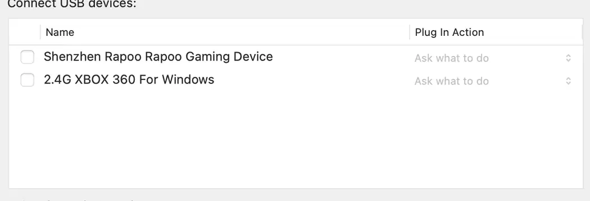
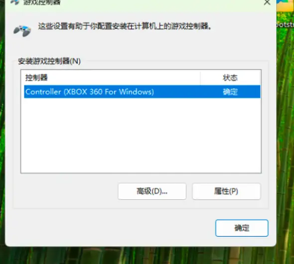
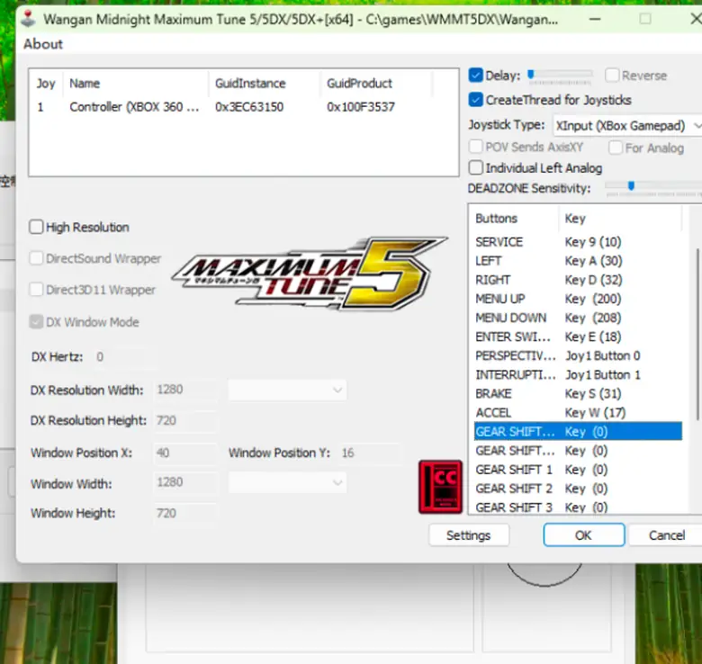

# 🏎️ WMMT5DX Apple Silicon Guide

### M 芯片 Mac 运行《湾岸5DX》及 Xbox 手柄适配指南

[返回 VMware HID 项目首页](../README.md) · [查看完整 HID Debug 报告](HID-Debug-Report.md)

本教程记录在 Apple Silicon Mac 上，通过 **VMware Fusion + Windows 11 ARM + JConfig** 运行《湾岸5DX》，并使用 Xbox 兼容手柄控制的实测过程。它是本仓库 HID 直通研究的原始应用案例。

## ✅ 测试环境与验证范围

| 项目 | 本次测试配置 |
|---|---|
| 电脑 | Apple Silicon Mac |
| 虚拟化 | VMware Fusion |
| 虚拟机操作系统 | Windows 11 ARM64 |
| 游戏 | Wangan Midnight Maximum Tune 5DX |
| 输入工具 | JConfig 1.8 |
| 手柄 | 盖世小鸡启明星 2（GameSir Nova 2 Lite） |
| 连接方式 | USB 数据线、绿色 Xbox/XInput 模式 |

**已实测**：Windows 能识别控制器；JConfig 接收 XInput 数字按钮；游戏内可使用手柄进入 Test Mode；方向盘、油门、刹车在游戏测试界面有响应。

**仍需验证**：`Fake Analog Pedals` 是否保留 RT/LT 的完整线性踏板精度；其他手柄型号和 VMware 版本的兼容性。

## 🔧 安装与配置

### 1. VMware USB 列表中的 Xbox 手柄

我们的可用配置中包含：

```ini
usb.generic.allowHID = "TRUE"
```

如需要编辑 `.vmx`，应先**完全关机** Windows、退出 VMware Fusion，并备份该文件；在 Finder 中打开 `.vmwarevm` 包的内容，使用纯文本编辑器操作，避免弯引号和重复键。**该参数在本次成功配置中存在，但我们未做独立删除对照，因此不声称它对所有环境都必需。**

重启后，在 VMware 的 USB 设备设置中寻找 Xbox 兼容设备；注意不要误把 Mac 键盘或鼠标直通到 Windows。此次鼠标曾显示 `Shenzhen Rapoo Rapoo Gaming Device`，并非手柄。



### 2. 直通手柄并在 Windows 测试

1. 通过 USB 数据线将手柄连接至 Mac，启明星 2 切换至绿色 Xbox／XInput 模式。
2. 在 VMware 「USB 与蓝牙」中，将 Xbox 兼容手柄连接至 Windows。
3. 在 Windows 按 `Win + R`，运行 `joy.cpl`。
4. 在 `Controller (XBOX 360 For Windows)` 的「属性」中验证左摇杆、LT、RT 与数字按钮。



**如果拔插后遇到 `The host requires this device for input`：** 我们已验证在 macOS 临时插入一只留给宿主机的 Rapoo 鼠标后，手柄可重新直通；连接建立后再移除鼠标，手柄仍可工作。详细实验、限制与风险见 [HID Debug 报告](HID-Debug-Report.md)。不要误把临时鼠标也直通进 Windows。

### 3. JConfig XInput 按键配置

打开 `JConfigWM5.exe`，将 `Joystick Type` 设为 **XInput (Xbox Gamepad)**。本次使用的按键配置：

| 游戏功能 | 手柄按键 |
|---|---|
| START | A |
| TEST MODE | View（Home 左边） |
| EXIT | Menu（Home 右边） |
| MENU UP / DOWN | 十字键上 / 下 |
| ENTER SWITCH | X |
| PERSPECTIVE | Y |
| INTERRUPTION | B |
| GEAR SHIFT UP / DOWN | RB / LB |
| 方向盘 | 左摇杆（水平） |
| ACCEL（油门） | RT |
| BRAKE（刹车） | LT |

本次测试中纯 XInput 模式下部分原键盘快捷键异常，因此将 Test Mode、Exit 等操作也绑定到手柄。不同手柄的映射可能不同。



### 4. JVS Settings：油门、刹车、方向盘

在 JConfig 的 `Settings` → `JVS Settings` 中，本次实际生效的组合为：

- `Fake Analog Steering wheel`：**关闭**
- `Fake Analog Pedals`：**开启**
- `ACCEL` 单独绑定到 **RT**，`BRAKE` 单独绑定到 **LT**
- `Terminal Emulator`：**开启**，`Terminal Mode`：**关闭**
- `FreePlay` 和 `Save Patch`：依原有可运行环境保持原样

本次是**同时完成 RT/LT 绑定与开启 Fake Analog Pedals** 后才在游戏中获得相应响应。

### 5. 游戏内验证

进入 `TEST MODE` → `入出力テスト` → `スイッチテスト`，推动左摇杆查看 `ハンドル`，按 RT 查看 `アクセル`，按 LT 查看 `ブレーキ`。验证数值随输入变化。由于没有保留证明变化过程的动态测试截图，这里不以静态截图作为模拟量已验证的证据。

## 🧩 常见问题

**Q：macOS 能识别手柄，但 VMware 的 USB 列表里没有？** 检查设备是否在正确输入模式下重新枚举、虚拟机是否完整关机后读取了 `.vmx` 设置，以及所选虚拟机是否正确。

**Q：设备显示出来了，但连接提示宿主机需要该输入设备？** 查看 [HID Debug 实验报告](HID-Debug-Report.md)，可尝试暂时连接另一只留给 macOS 的外接鼠标。

**Q：Windows `joy.cpl` 成功，但游戏中按键不响应？** 检查 JConfig 的 XInput 模式和按键绑定，使用游戏 Test Mode 验证。

**Q：方向盘可以，但 RT/LT 油门刹车没有反应？** 重新绑定 RT、LT，并在 JVS Settings 开启 `Fake Analog Pedals`，保存并重启游戏后测试。

## 📜 许可与第三方权利

本仓库中有权授权的原创文字及原创截图采用 [CC BY 4.0](../LICENSE)。第三方游戏、商标、软件、脚本和界面内容仍归原权利人。本项目不提供游戏本体、破解文件、未经授权的程序及下载链接，亦与 Bandai Namco、VMware、GameSir 无官方关联。
